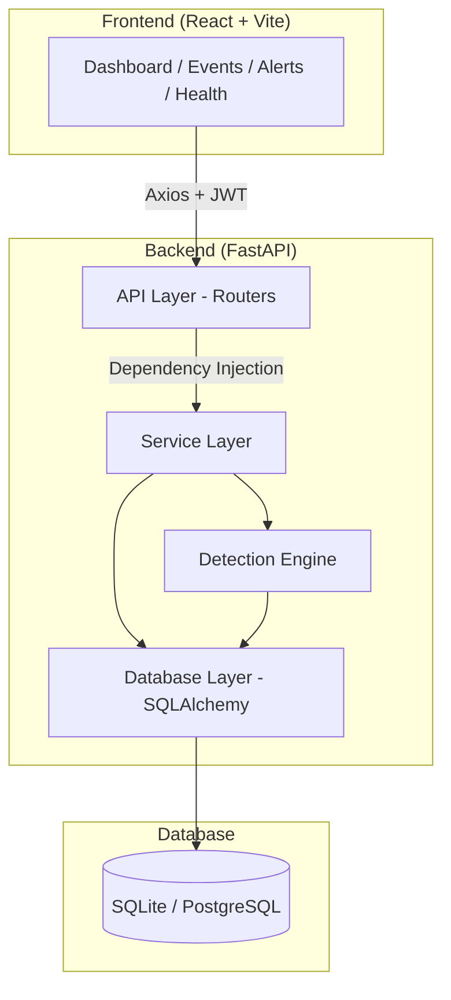

# 🛡️ SecureOps

**Cybersecurity Monitoring & Threat Detection Platform**

SecureOps is a full-stack security monitoring platform that collects security events, analyzes them using a rule-based detection engine, assigns severity levels, generates alerts, and presents the results through a professional web dashboard.

Built as a portfolio-grade project demonstrating practical skills in cybersecurity, Python, FastAPI, React, and secure software development.

---

## 🎯 Features

- **Security Dashboard** — Real-time overview with event timeline, severity distribution, and top threat sources
- **Event Management** — Submit, search, filter, and view security events with full detail
- **Threat Detection Engine** — 5 modular detection rules that automatically analyze events and generate alerts
- **Alert Management** — Track alerts through open → investigating → resolved workflow
- **JWT Authentication** — Secure login with role-based access (analyst/admin)
- **System Health** — Monitor API status, database connectivity, and uptime
- **Dark SOC Interface** — Professional cybersecurity-themed UI with glassmorphism design
- **Docker Ready** — Single command deployment with Docker Compose

---

## 🏗️ Architecture



---

## 🛠️ Tech Stack

| Layer | Technology |
|-------|-----------|
| **Backend** | Python 3.11+, FastAPI, Uvicorn, SQLAlchemy, Pydantic |
| **Frontend** | React 18, TypeScript, Vite, Tailwind CSS 3, Recharts |
| **Database** | SQLite (dev) / PostgreSQL (prod) |
| **Auth** | JWT (python-jose), bcrypt (passlib) |
| **Testing** | pytest, FastAPI TestClient |
| **DevOps** | Docker, Docker Compose |

---

## 📁 Project Structure

```
secureops/
├── backend/
│   ├── app/
│   │   ├── api/            # FastAPI routers
│   │   ├── core/           # Config, security, logging
│   │   ├── db/             # Database models & session
│   │   ├── detection/      # Detection rules & severity
│   │   ├── schemas/        # Pydantic request/response models
│   │   ├── services/       # Business logic layer
│   │   ├── main.py         # FastAPI application
│   │   └── seed.py         # Demo data seeder
│   ├── tests/              # pytest test suite
│   ├── requirements.txt
│   └── Dockerfile
├── frontend/
│   ├── src/
│   │   ├── components/     # Reusable UI components
│   │   ├── hooks/          # Auth context & hooks
│   │   ├── pages/          # Page components
│   │   ├── services/       # API client
│   │   └── types/          # TypeScript definitions
│   ├── package.json
│   └── Dockerfile
├── docs/                   # Architecture, API, detection rules docs
├── sample_data/            # Sample security events JSON
├── docker-compose.yml
├── .env.example
└── README.md
```

---

## 🔍 Detection Engine

The detection engine evaluates 5 rules against every incoming security event:

| Rule | Severity | Trigger |
|------|----------|---------|
| Multiple Failed Logins | HIGH | ≥3 failed logins from same IP in 10 min |
| Suspicious Port Activity | MEDIUM | Connection attempts to restricted ports |
| Privilege Escalation | CRITICAL | Unauthorized admin actions or privilege changes |
| Suspicious Authentication | HIGH | Impossible travel, credential stuffing |
| Malware Indicator | CRITICAL | Known test malware signatures detected |

See [docs/detection-rules.md](docs/detection-rules.md) for detailed documentation.

---

## 🔗 API Endpoints

| Method | Endpoint | Auth | Description |
|--------|----------|------|-------------|
| GET | `/` | No | API status |
| GET | `/health` | No | System health check |
| POST | `/api/auth/register` | No | Register user |
| POST | `/api/auth/login` | No | Login, get JWT |
| GET | `/api/events` | Yes | List events (search/filter/paginate) |
| POST | `/api/events` | Yes | Submit event → detect → alert |
| GET | `/api/events/{id}` | Yes | Event details + alerts |
| GET | `/api/alerts` | Yes | List alerts |
| GET | `/api/alerts/{id}` | Yes | Alert details |
| PATCH | `/api/alerts/{id}` | Yes | Update alert status |
| GET | `/api/dashboard/stats` | Yes | Dashboard statistics |
| GET | `/api/dashboard/timeline` | Yes | Timeline & chart data |
| GET | `/docs` | No | Swagger API docs |

See [docs/api.md](docs/api.md) for request/response examples.

---

## 🚀 Installation

### Prerequisites
- Python 3.11+
- Node.js 18+
- npm

### 1. Clone the repository
```bash
git clone https://github.com/yourusername/secureops.git
cd secureops
```

### 2. Set up environment
```bash
cp .env.example .env
# Edit .env with your SECRET_KEY (generate a random one for production)
```

### 3. Backend setup
```bash
cd backend
python -m venv venv
# Windows:
.\venv\Scripts\activate
# Linux/Mac:
source venv/bin/activate

pip install -r requirements.txt
```

### 4. Frontend setup
```bash
cd frontend
npm install
```

---

## 💻 Local Development

### Start Backend
```bash
cd backend
.\venv\Scripts\activate     # Windows
uvicorn app.main:app --reload
```
Backend runs at: http://localhost:8000  
API docs at: http://localhost:8000/docs

### Start Frontend
```bash
cd frontend
npm run dev
```
Frontend runs at: http://localhost:5173

### Demo Credentials
| Role | Username | Password |
|------|----------|----------|
| Analyst | `analyst` | `SecureOps2024!` |
| Admin | `admin` | `SecureOpsAdmin2024!` |

---

## 🐳 Docker Setup

```bash
docker compose up --build
```

- Frontend: http://localhost:3000
- Backend API: http://localhost:8000
- API Docs: http://localhost:8000/docs

---

## 🧪 Testing

```bash
cd backend
.\venv\Scripts\activate
python -m pytest tests/ -v
```

Tests cover:
- Authentication (register, login, token validation)
- Event CRUD and auto-severity classification
- Detection engine rule triggers
- Dashboard statistics
- Health endpoint
- Protected endpoint access

---

## 📡 Example Security Events

Submit via API or use the pre-seeded demo data:

```bash
curl -X POST http://localhost:8000/api/events \
  -H "Authorization: Bearer <token>" \
  -H "Content-Type: application/json" \
  -d '{
    "source": "auth-server",
    "source_ip": "192.168.1.50",
    "destination_ip": "192.168.1.10",
    "event_type": "failed_login",
    "description": "Multiple failed authentication attempts detected",
    "raw_data": {"username": "jdoe", "attempts": 5}
  }'
```

---

## 🔒 Security Considerations

- Passwords hashed with bcrypt (never stored as plaintext)
- JWT authentication with configurable expiration
- Input validation on all API endpoints (Pydantic schemas)
- Parameterized database queries via SQLAlchemy ORM
- Environment-based secrets (never hardcoded)
- CORS restricted to configured origins
- No sensitive data in error responses or logs
- Role-based access control

---

## 🔮 Future Improvements

- [ ] Real-time WebSocket event streaming
- [ ] Email/Slack alert notifications
- [ ] SIEM integration (Splunk, ELK)
- [ ] Machine learning anomaly detection
- [ ] Rate limiting and API throttling
- [ ] Audit logging
- [ ] Multi-tenancy support
- [ ] PostgreSQL migration with Alembic
- [ ] CI/CD pipeline (GitHub Actions)
- [ ] Event correlation engine

---

## 👤 Author

Built as a cybersecurity and software development portfolio project.

---

## 📄 License

This project is licensed under the MIT License — see the [LICENSE](LICENSE) file for details.
